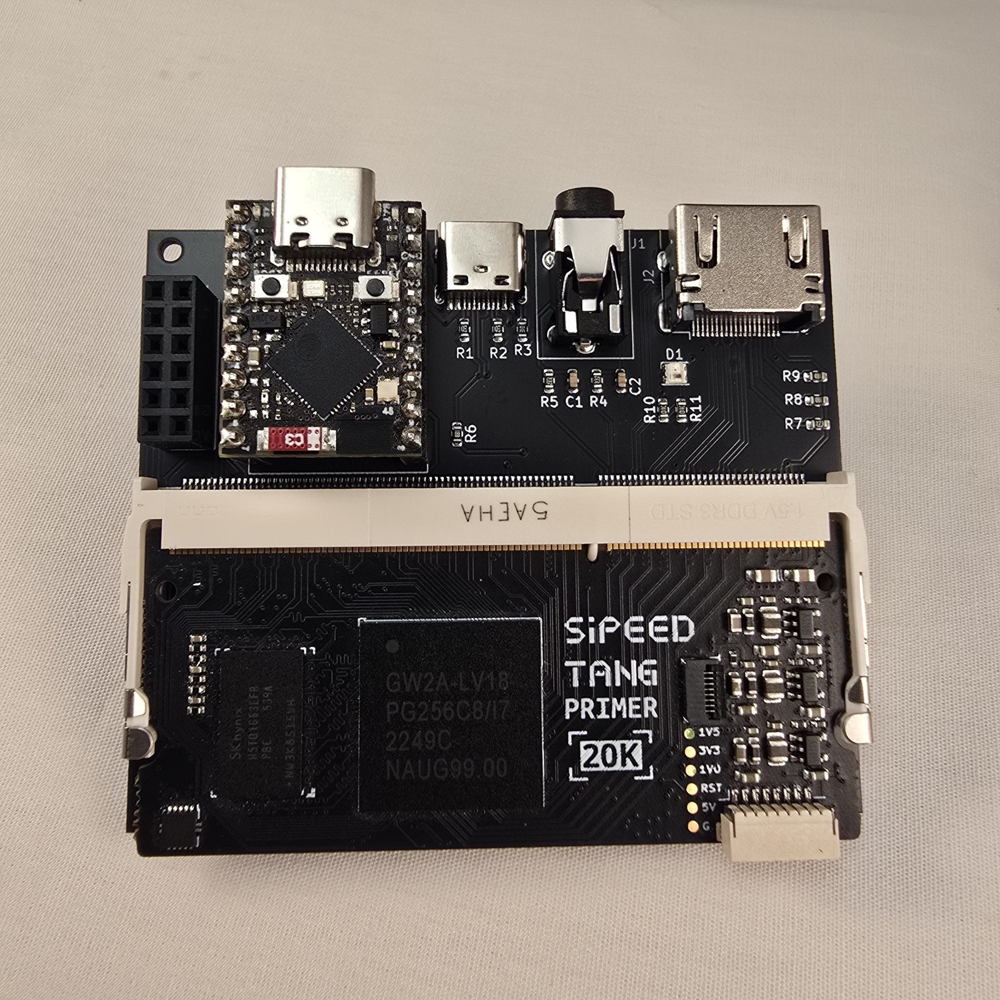

# Flash the Firmware

Before anything else works, the ESP32-S3 SuperMini needs two pieces of software: the **Papilio ESP Bootloader**, which lets you program and recover the board, and the **FPGA-Companion** app, which provides the on-screen menu, ROM loading, and controller support for the game core running on the FPGA. This page installs both in one step. If you need a refresher on how the system works, see the [Retrocade Overview](./index.md).

:::tip[Prefer no install at all?]
The **[browser-based Board Recovery page](https://papilioworks.com/board-recovery/)** does this whole page — bootloader recovery, WiFi setup, the latest A2600 core, and the Papilio Splash ROM — from a single guided page in Chrome or Edge, no download or install required. Use it instead of the manual setup below if you'd rather not install Papilio Loader locally.
:::

---

## What You Need

- ESP32-S3 SuperMini (not yet plugged into the Retrocade for this step)
- USB-C cable
- Chrome or Edge with Web Serial support for the browser-based setup, or Papilio Loader for manual flashing
- A USB data cable, not a charge-only cable

---

## Recommended: Browser-Based Setup

**Watch: Set Up a Board with the Board Recovery Page (2 minutes)**

  <iframe
    src="https://www.youtube-nocookie.com/embed/sPk5SLPhIqc"
    title="Set Up a Papilio Retrocade with One Web Page"
    style={{position: 'absolute', top: 0, left: 0, width: '100%', height: '100%', border: 0}}
    allow="accelerometer; clipboard-write; encrypted-media; gyroscope; picture-in-picture; web-share"
    referrerPolicy="strict-origin-when-cross-origin"
    allowFullScreen
  />

The [browser-based Board Recovery page](https://papilioworks.com/board-recovery/) is the easiest way to prepare a blank board. It downloads the current Papilio ESP32 Bootloader, FPGA Companion ESP32 app, A2600 Retrocade FPGA core, and Papilio Splash ROM from their published releases and performs the complete first-time flow in three steps:

1. Hold the **BOOT** button on the ESP32-S3 while you plug in the USB cable. This is the most reliable way to start: it puts the board straight into its programming mode, so the page does not have to reset it.
2. Open the Board Recovery page in Chrome or Edge.
3. **Step 1 — Install / Recover ESP32:** if you want the board on WiFi, type your network name and password (2.4 GHz only; optional). Click **Connect USB**, select the first of the serial ports shown for the Retrocade's ESP32 (if it can't connect, try the other one), then click **Install / Recover Board**. The WiFi settings are written to the board during the install, over USB, and never sent over the internet. When it finishes, the board restarts into FPGA-Companion, joins your network, and the page shows its IP address.
4. **Step 2 — Install the A2600 core:** click **Install Latest A2600 Core**. The page uses WiFi when the board IP is known, or USB serial when it is not.
5. **Step 3 — Load a demo game ROM:** insert a FAT-formatted SD card, then click **Load Papilio Splash ROM**. The page uploads the ROM to the SD card and starts it on the A2600 core.

When you connect the Retrocade over USB, the ESP32 usually appears as two serial ports. If you are not sure which ports belong to the board, unplug it and note which ports disappear, then plug it back in and watch for those ports to return. Select the first port listed; if the page reports that it can't connect, try the other one.

The ROM upload requires WiFi and a known device IP (from Step 1, or from **Advanced tools**), as well as a FAT-formatted SD card.

**Advanced tools** (collapsed at the bottom of the page): add your WiFi later if you skipped it in Step 1, **Find My IP** and **Use This IP** for a board that is already on WiFi, and **Restart Board (USB)**.

:::note[The video shows the earlier page]
The video above was recorded before the page was simplified. It shows four steps, with WiFi as its own step. The page now has three: your WiFi goes into Step 1, the A2600 core is Step 2, and the ROM is Step 3. An updated video is planned.
:::

The recovery image writes the factory bootloader and a compatible Companion application in one USB operation. Use it for a new board or to migrate a board that still uses the older application-centered layout.

:::warning[Use the recovery image only for migration]
Do not flash a normal FPGA-Companion application image over the factory partition. After migration, update the application with Papilio Loader, which installs app-only updates safely beside your current version.
:::

---

## Manual Setup with Papilio Loader

Papilio Loader is the official tool for programming Papilio hardware. It can program the **ESP32 firmware** and **FPGA bitstreams** over **USB** or **WiFi**:

- **USB:** recover or program the ESP32, and program the FPGA when WiFi is unavailable.
- **WiFi:** update the ESP32 application and program the FPGA remotely after the board has joined your network.

Use the **[Web Edition](https://papilioworks.com/loader/)** in Chrome or Edge with nothing to install, or install the Windows **Desktop App**: download `PapilioLoader-Setup-x.x.x.exe` from the [releases page](https://github.com/Papilio-Labs/papilio-loader/releases) and launch **Papilio Loader** from the Start Menu.

:::tip
Papilio Loader can do more than first-time setup, including finding boards on your network, a saved files library, live WiFi logs, and AI assistant support. See the full [Papilio Loader documentation](../papilio-loader/index.md).
:::

---

## Manual Migration

1. Hold the **BOOT button** on the ESP32-S3 SuperMini
2. Plug in the USB-C cable while holding BOOT
3. Release BOOT after 2 seconds — the device is now in ROM download mode
4. Use the migration image from the browser-based Getting Started flow, or from the [FPGA-Companion v2.2.1 release](https://github.com/Papilio-Retrocade/FPGA-Companion/releases/tag/v2.2.1) (`papilio-migration-v2.2.1-merged.bin`)
5. In Papilio Loader, choose the migration `.bin` on the **ESP32 Flash** card. Loader recognizes the merged image and writes it from the start of flash.
6. Click **Program ESP32**, authorize the board's USB port if prompted, and wait for it to finish.
7. Add your WiFi under **Advanced tools** on the [Board Recovery page](https://papilioworks.com/board-recovery/), and use Papilio Loader for future updates.

---

## Verify the Migration

1. After reflashing, unplug USB from your computer
2. Plug the ESP32-S3 SuperMini into the Retrocade board header
3. Connect HDMI to a monitor
4. Power the board through the ESP32-S3 SuperMini's USB-C port
5. You should see the FPGA-Companion OSD on your screen. The bootloader remains installed in the factory partition and continues to provide recovery and update services independently of the OSD application.

When fully assembled, the system looks like this — ESP32-S3 in its header at the top-left, Tang Primer 20K in the SO-DIMM socket:

:::tip
If you see nothing on screen, check that the HDMI cable is connected to the **Retrocade board** (not the Tang Primer 20K). Also confirm the ESP32-S3 is seated fully in its header pins.
:::

---

## Troubleshooting

| Symptom | Fix |
|---|---|
| Device not detected by computer | Try a different USB-C cable — many are charge-only with no data lines |
| Flash fails with "port not found" | Check Device Manager (Windows) or `ls /dev/tty*` (Linux/Mac) for the correct port |
| Nothing on HDMI after flash | Confirm ESP32-S3 is in the correct header orientation |
| Green LED doesn't blink | Re-flash the migration image from the start of flash. Confirm you used the Retrocade-specific migration image, not an app-only FPGA-Companion build |
| Step 1 says the board did not respond, or *Failed to set control signals* | The page could not reset the board into its programming mode. Unplug the USB cable, hold **BOOT** while plugging it back in, then click **Install / Recover Board** again. If the page tells you to reload, reload it first |
| The board looks idle after the install, or has no WiFi | Skipped WiFi in Step 1? Add it under **Advanced tools**. To restart the board, use **Restart Board (USB)** there, or unplug and replug the USB cable |

---

## Next Step

Firmware is installed. Now push a game core to the FPGA:

**[Load a Core →](./load-a-core)**

---

## 🎓 Want to Go Deeper?

Understanding what FPGA-Companion is actually doing when it talks to the FPGA is fascinating. The FPGA Fundamentals course covers JTAG, the SPI communication between ESP32 and FPGA, and how to use AI to write your own peripheral bridges.

**[FPGA Fundamentals: AI as Your Co-Developer →](https://learn.papilioworks.com)**
