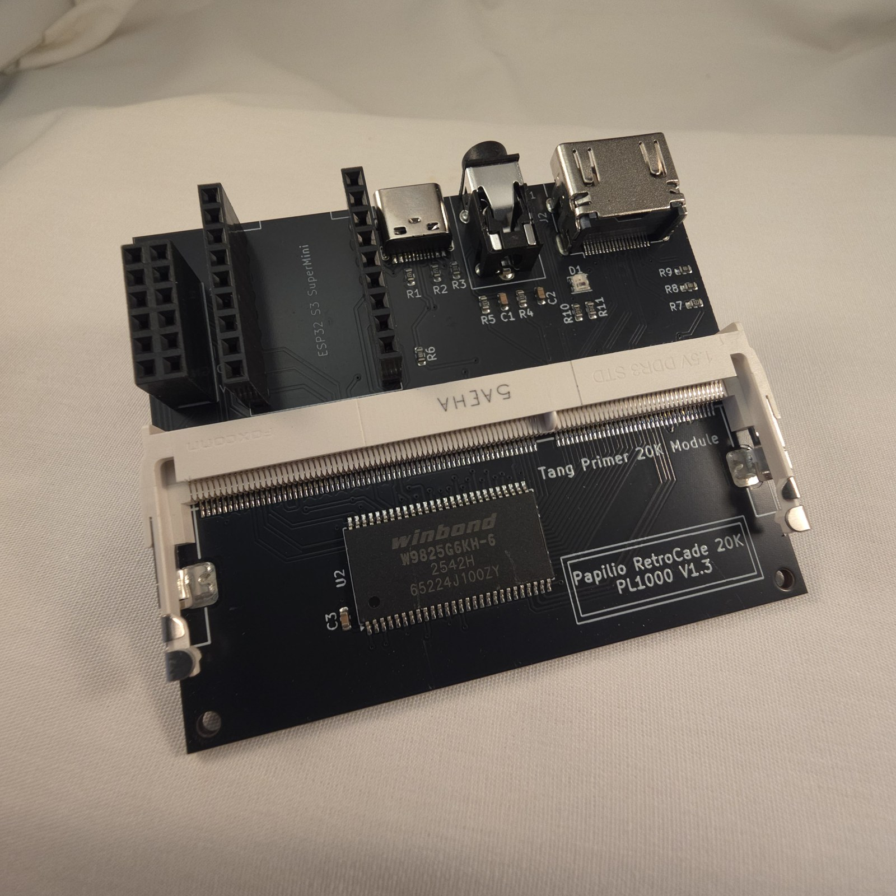
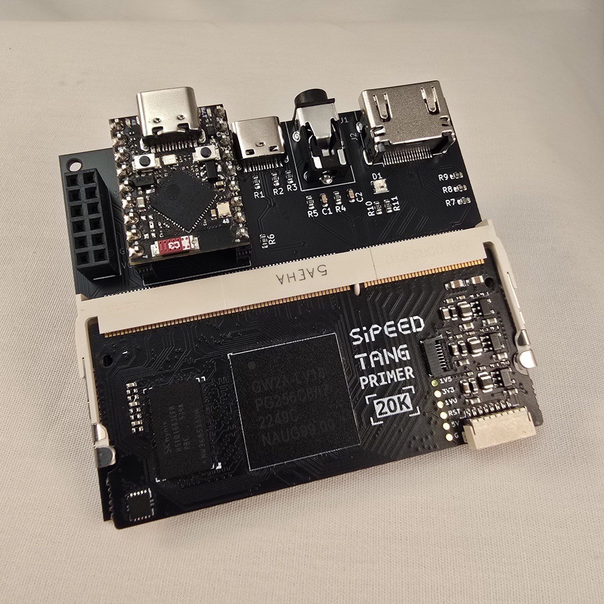

# Papilio Retrocade Daughterboard

Designed by Papilio Works. The main expansion board that connects the Tang Primer 20K FPGA module to the outside world.

Along the top edge, left to right: ESP32-S3 SuperMini header, a USB-C port wired to the FPGA, 3.5mm audio jack, and HDMI output. The Tang Primer 20K clips into the SO-DIMM socket below, and the Winbond SDRAM sits on the lower half of the board.

The board has two USB-C ports once assembled. Use the **ESP32-S3 SuperMini's** USB-C port in general: it powers the board and connects it to your computer. The Retrocade board's own USB-C port is wired to the FPGA. For now it supplies power when the ESP32's port is acting as a USB host for a keyboard, mouse or gamepad; the port is fully functional and may do more in the future.

---

## Specifications

| Feature | Detail |
|---|---|
| SDRAM | Winbond W9825G6KH-6, 32 MB, 166 MHz |
| Video | HDMI output (differential pair) |
| Audio | 3.5mm stereo analog jack |
| Power | 5V USB-C: through the ESP32-S3 SuperMini's port normally, or the board's FPGA USB-C port while the ESP32 port is a USB host |
| Expansion | PMOD connector (standard 12-pin) |
| Status LED | WS2812B RGB |
| Programmer | Onboard JTAG |
| FPGA Header | SO-DIMM-style, 200-pin |

---

:::note[Content Coming Soon]
Schematic reference, CST file pinout, and PCB dimension drawing will be added here.

The Retrocade board's hardware design is not open source. The firmware (FPGA-Companion) and the core ports are: [github.com/Papilio-Retrocade](https://github.com/Papilio-Retrocade)
:::

---

## 🎓 Want to Go Deeper?

The full hardware design story — why this board was designed this way, KiCad design files, schematic review, and how to spin your own expansion board:

**[Building FPGA Hardware Products →](https://learn.papilioworks.com)**
