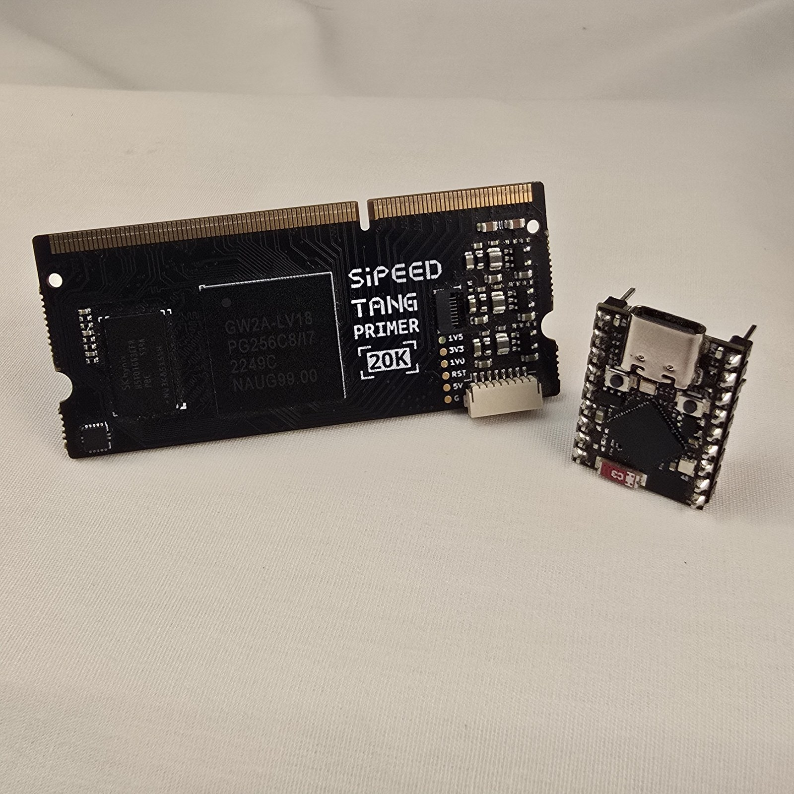

# Sipeed Tang Primer 20K

The FPGA core module. Made by Sipeed. Plugs into the Retrocade's SO-DIMM-style header.

The Gowin GW2A-LV18 FPGA and 128 MB DDR3 dominate the module; the gold SO-DIMM edge connector along the top carries all I/O to the Retrocade board. Shown with the ESP32-S3 SuperMini for scale.

---

## Specifications

| Feature | Detail |
|---|---|
| FPGA | Gowin GW2A-LV18PG256C8/I7 |
| Logic Elements | 20,736 LUTs |
| On-Module Memory | 128 MB DDR3 SDRAM |
| Flash | 32 Mbit NOR Flash |
| Clock | 27 MHz oscillator |
| Available I/O | 117 pins |
| Form Factor | SO-DIMM 200-pin module |

---

## Where to Buy

The Tang Primer 20K is made by Sipeed. **We recommend buying it directly from the [Sipeed Store on AliExpress](https://www.aliexpress.us/item/3256804466994057.html).** Prices there have generally been lower than from resellers on Amazon and other marketplaces. We don't sell or resell the module, so purchase, shipping and returns are handled by the seller you buy from.

:::warning[Buy the right board]
You need the **Tang Primer 20K core module**: the SO-DIMM board with the Gowin GW2A-LV18 FPGA. It is not the **Tang Nano 20K**, and you don't need a carrier board. The **20K Dock kit** includes the same core module plus a dock board and cables that the Retrocade doesn't use. It is a fine choice if it is cheaper than the module alone. On the AliExpress listing, choose the **20K Core Board** or **20K Dock Kits** bundle option.
:::

Prices on the Sipeed Store change often and vary by country and promotion. In early November 2026 the module alone was about $46, and new-shopper promotions (limited to one per new account) were much lower. Check the store for the current price.

---

:::note[Content Coming Soon]
Detailed I/O mapping, JTAG pinout, and Gowin EDA toolchain setup instructions will be added here.
:::

---

## 🎓 Want to Go Deeper?

Setting up the Gowin EDA toolchain, understanding the Gowin synthesis flow, and using AI to write Verilog for the GW2A-18:

**[FPGA Fundamentals: AI as Your Co-Developer →](https://learn.papilioworks.com)**
